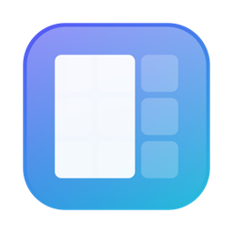
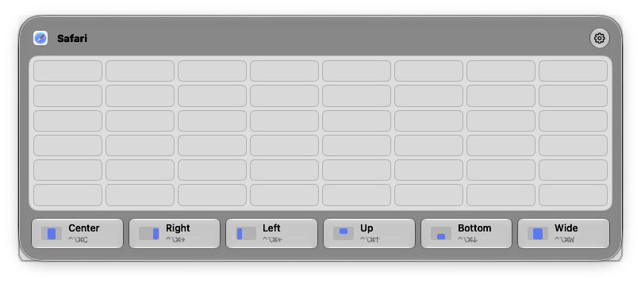
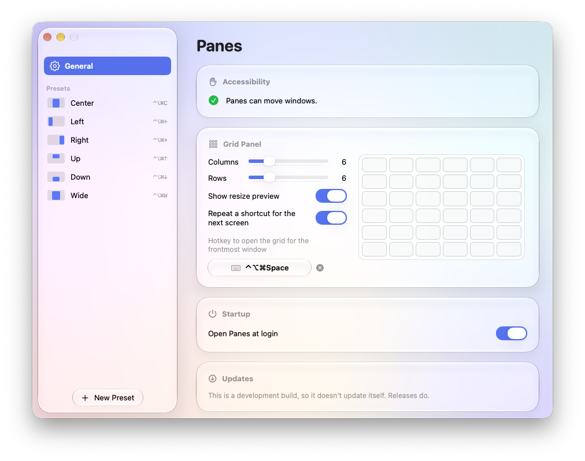
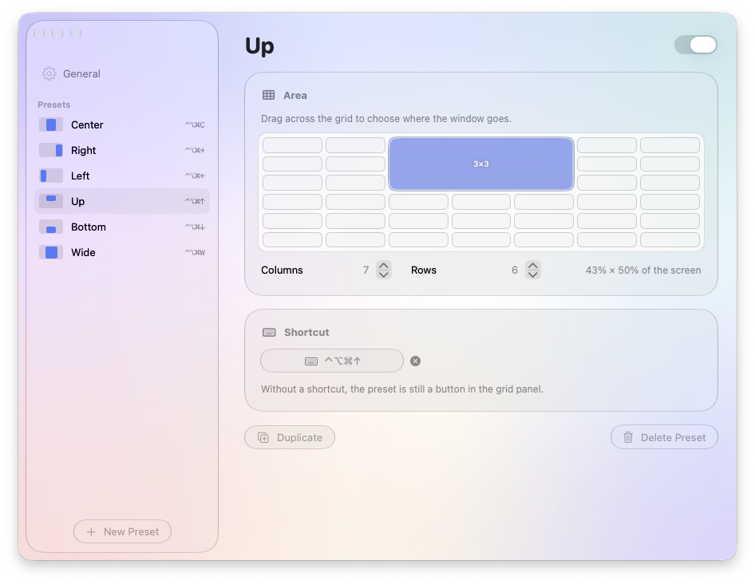

<p align="center">
  
</p>

<h1 align="center">Panes</h1>

<p align="center">A native Apple Silicon window grid for macOS, after Divvy.<br>
Drag across a grid to place the front window, or press a shortcut.</p>

---

[Divvy](https://mizage.com/divvy/) has not been updated since 2017 and ships Intel code only, so on an
Apple Silicon Mac it runs through Rosetta, which Apple is phasing out. Panes rebuilds Divvy's
behaviour as a native arm64 app with a Liquid Glass interface. On first launch it imports your Divvy
presets.



## Features

- **Drag-to-place grid.** Click the menu-bar icon or press the grid hotkey: a grid opens centred on the
  screen of the front window. Drag across the cells you want; on release the window fills that zone.
- **Resize preview.** While you drag, or hover a preset button, a glass outline on the real screen
  shows where the window will land.
- **Follows your display settings.** Reduce Motion swaps the panel's turn for a cross-fade; Reduce
  Transparency and Increase Contrast make the grid solid and its cells easier to count.
- **Presets with global shortcuts.** Each preset is a grid area. Give it a shortcut (⌃⌥⌘← and so on)
  or leave it as a button in the grid panel.
- **Settings window** to create, duplicate, reorder and delete presets, record shortcuts, and set the
  grid size. Shortcut conflicts are flagged next to the preset.
- **Divvy import.** Your Divvy grid size and shortcuts, including subdivided grids, are converted on
  first launch and can be re-imported from Settings.
- **Keyboard-layout aware.** Shortcuts follow the active layout, so a Divvy shortcut stored as the
  QWERTY "Z" key shows as ⌃⌥⌘W on AZERTY, which is the key it really is.
- **Multiple screens.** Windows are placed on the screen they're mostly on, inside the menu bar and Dock.
  With several screens, the grid panel shows a row of screen icons, the main one first: click one to
  place the window there instead. Optionally, pressing a preset's shortcut again sends the window to
  the same area of the next screen.
- **Updates itself.** Release builds check GitHub once a day and install a new version in one click,
  after checking its signature.
- Menu-bar only, with no Dock icon except while Settings is open. Optionally opens at login.

| General | Preset editor |
| --- | --- |
|  |  |

## Requirements

- An Apple Silicon Mac running **macOS 26** or later (Liquid Glass needs it).
- **Xcode** with Swift 6.2 or later, to build.

## Install

Download `Panes-<version>.dmg` from the [latest release](https://github.com/mp-consulting/panes/releases/latest),
open it and drag Panes to Applications. Releases are signed and notarized, and update themselves (see
[Updates](#updates)). To build from source instead:

```sh
scripts/create-signing-identity.sh   # once per Mac, see "Signing" below
scripts/build-app.sh --install       # builds, copies to ~/Applications, launches
```

`build-app.sh` alone builds `Panes.app` into `~/Library/Caches/Panes/dist/` without installing it.

Then:

1. **Quit Divvy** (and any other window manager using the same shortcuts). Panes flags a shortcut that
   another app already holds.
2. **Allow Accessibility access.** macOS asks on first launch, or go to System Settings → Privacy &
   Security → Accessibility and turn Panes on. Panes needs it to move other apps' windows.
3. Optionally turn on **Open Panes at login** in Settings → General.

### Signing

Accessibility access is tied to the app's code signature. With an ad-hoc signature (no certificate)
every rebuild counts as a new app, and macOS asks for access again even though System Settings still
shows Panes as allowed. `scripts/create-signing-identity.sh` creates a self-signed certificate,
**Panes Local Signing**, in your login keychain. `build-app.sh` uses it automatically, so one grant
survives every rebuild. To sign with another identity, set `SIGN_IDENTITY`.

If you switch from ad-hoc to the certificate, remove the old Panes entries from the Accessibility
list once and allow the new one.

## Using it

| Action | How |
| --- | --- |
| Open the grid | Click the menu-bar icon, or press the grid hotkey (set in Settings → General) |
| Place the window | Drag across the grid and release, or click a preset button |
| Place it on another screen | In the grid, click that screen's icon at the top right first. With **Repeat a shortcut for the next screen** on, press a preset's shortcut again |
| Apply a preset | Press its shortcut, with the window to place in front |
| Cancel a drag | Escape before releasing the mouse: the window stays put and the grid closes |
| Close the grid | Escape, the hotkey again, or click elsewhere |
| Settings | Click the gear in the grid: the panel turns over to the full settings, and the arrow at the top left turns it back. Or right-click (or Control-click) the menu-bar icon |
| Quit | Right-click (or Control-click) the menu-bar icon |

In the **preset editor**, drag on the grid to set the area. Columns and rows can change per preset,
and the selected area is rescaled to stay the same part of the screen. Click the shortcut button and
press a key combination to record it. Escape cancels, and × clears it. A shortcut needs cmd, ctrl or
opt; shift alone is only enough on F1–F15, since elsewhere it would take over typing capitals or
selecting text.

## Updates

Release builds ask GitHub once a day whether a newer release exists: one request to `api.github.com`,
which sees your IP address and, in the User-Agent, the Panes version. Nothing else is sent. When there
is one, an arrow appears in the grid panel, the menu-bar menu offers it, and Settings → General →
Updates shows **Install and Relaunch**. The daily check can be turned off there; **Check Now** still
works.

Before replacing anything, Panes downloads the release's disk image and checks that it is notarized
and signed with the developer's Developer ID, then that the app inside carries Panes's identifier, the
same signature and the release's version. It then swaps the app in place and relaunches. Accessibility
access carries over, since the signature is the same. Panes must be able to write to the folder it
runs from: when it can't, or when it runs straight from the disk image, Settings offers **Download**
instead.

Builds you make yourself (ad-hoc or **Panes Local Signing**) never check for updates.

## Configuration file

Settings are saved as JSON in `~/Library/Application Support/Panes/config.json`. Settings → General has
a **Show in Finder** button. The app reads the file at launch and rewrites it on every change, so quit
Panes before editing it by hand. If the file can't be read at launch, Panes renames it to
`config-unreadable-<date>.json`, starts from Divvy's settings or the defaults, and says so in Settings.

```json
{
  "grid": { "columns": 7, "rows": 6 },
  "gridHotkey": "ctrl+opt+cmd+space",
  "showResizePreview": true,
  "checkForUpdates": true,
  "cycleScreens": false,
  "presets": [
    {
      "name": "Left",
      "key": "ctrl+opt+cmd+left",
      "enabled": true,
      "area": { "columns": 7, "rows": 6, "start": { "column": 0, "row": 0 }, "end": { "column": 1, "row": 5 } }
    }
  ]
}
```

- `area` is a cell range on its own `columns` × `rows` grid. Row 0 is the top row, and both ends are
  included.
- `grid` sizes are kept to 1–24 columns and rows, and an `area` grid to 1–48; values outside are
  brought into range when the file is read.
- `key` is modifiers plus a key, joined with `+`: modifiers `ctrl`, `opt`, `shift`, `cmd`; keys are a
  character on the active layout (`w`, `é`), or `left`, `right`, `up`, `down`, `space`, `return`,
  `tab`, `escape`, `delete`, `home`, `end`, `pageup`, `pagedown`, `f1`–`f15`, `keypad0`–`keypad9`. An
  empty `key` makes a button-only preset.
- `id` and `enabled` can be left out; Panes fills them in.
- `checkForUpdates` turns the daily update check on or off. It's on when left out.
- `cycleScreens`: when on, pressing a preset's shortcut again, with the window still where that
  shortcut put it, moves the window to the same area of the next screen, left to right, wrapping round.
  It's off when left out.

## Divvy settings that are not carried over

Divvy's resize preview and monitor cycling are reproduced. These other Divvy options are not:

- **Margins** between windows and around the screen edges.
- **Animations** when windows move.
- Divvy's hidden `enableAcceleration` preference needs no counterpart. Despite its name, it only
  records that Divvy has been launched before, for its licence prompt.

## Troubleshooting

| Symptom | Cause and fix |
| --- | --- |
| macOS asks for Accessibility although Panes is allowed | The build is signed ad-hoc. Run `scripts/create-signing-identity.sh`, rebuild, re-allow once. |
| A shortcut shows "Another app already uses this shortcut" | Another app holds the key combination, often Divvy or a second copy of Panes. Quit it (Panes takes the shortcut as soon as it does) or pick another shortcut. |
| A shortcut does nothing | The front app has no focused window (the Finder desktop, for example), or Accessibility is off. Panes beeps. |
| `codesign` fails with "resource fork, Finder information, or similar detritus" | The build output is inside an iCloud-synced folder. `build-app.sh` builds in `~/Library/Caches/Panes`, so use the script, or pass `--scratch-path` to `swift build`. |

## Development

`bin/dev` wraps the everyday commands (`bin/dev help` lists them all):

```sh
bin/dev test       # unit tests
bin/dev build      # debug build
bin/dev install    # release build into ~/Applications, relaunched
bin/dev screen     # a virtual second screen until Ctrl-C, with a live view of it
bin/dev screens    # the connected screens, as Panes sees them
```

`bin/dev screen` makes it possible to test placement across screens without a second monitor. It
uses macOS's private `CGVirtualDisplay` API, as DeskPad and BetterDisplay do. Nothing shows a virtual
display, so a window on the main screen mirrors it. That window needs Screen Recording for the app you
run the command from; `--no-view` skips it. `bin/dev screen 2560 1440` picks another size, and System
Settings → Displays arranges it like any monitor. Adding or removing a display can switch HDR off on
your real screens, so the tool turns it back on for every screen that had it, again on exit.

The project is a Swift package with no dependencies:

| Path | What it holds |
| --- | --- |
| `Sources/PanesCore/` | Pure logic: grid geometry, shortcut parsing, the config format, the Divvy importer, release versions. Fully unit-tested. |
| `Sources/Panes/System/` | macOS plumbing: Carbon global hotkeys, the Accessibility window mover, keyboard-layout lookup, the updater. |
| `Sources/Panes/UI/` | SwiftUI and AppKit: the grid panel, the resize preview, the settings window, the shortcut recorder. |
| `Sources/Panes/AppDelegate.swift`, `Store.swift` | The menu-bar item, hotkey wiring, and the config store that saves to disk. |
| `Tests/PanesCoreTests/` | Tests for `PanesCore`, including an import of a Divvy-shaped keyed archive. |
| `bin/dev` | Entry point for the commands above. |
| `scripts/` | `build-app.sh` (bundle, sign, install), `make-dmg.sh` (disk image), `make-icon.swift` (renders the icon), `create-signing-identity.sh`, `virtual-screen/` (the test screen), `list-screens.swift`. |

Divvy's shortcuts live in its preferences as an `NSKeyedArchiver` blob of `Shortcut` objects.
`DivvyImport` walks that archive as a plain property list, so no Divvy class is needed.

## Releases

Publishing a GitHub release runs [`.github/workflows/release.yml`](.github/workflows/release.yml):
it tests, builds with the version from the tag (`v1.2.0` → `1.2.0`), signs with a Developer ID
certificate, packs `Panes-<version>.dmg` with `scripts/make-dmg.sh`, notarizes it and attaches it
to the release. Before tagging, move the `[Unreleased]` entries in [CHANGELOG.md](CHANGELOG.md) under
the new version. The workflow needs these repository secrets:

| Secret | Value |
| --- | --- |
| `DEVELOPER_ID_CERTIFICATE` | Your **Developer ID Application** certificate and key, exported from Keychain Access as `.p12`, then `base64 -i cert.p12 \| pbcopy` |
| `DEVELOPER_ID_CERTIFICATE_PASSWORD` | The password you gave the `.p12` export |
| `APPLE_API_KEY` | The contents of an App Store Connect API key (`AuthKey_<id>.p8`), for notarization: `gh secret set APPLE_API_KEY < AuthKey_<id>.p8` |
| `APPLE_API_KEY_ID` | That key's ID (the `<id>` in the file name) |
| `APPLE_API_ISSUER` | The issuer ID shown above the key list (App Store Connect → Users and Access → Integrations) |

Without `APPLE_API_KEY` the DMG is signed but not notarized, and Gatekeeper blocks it on other Macs.
A release signed with Developer ID is a different signature from a local build, so macOS asks for
Accessibility access once more after switching.

To make a DMG locally: `scripts/build-app.sh && scripts/make-dmg.sh`.

## Contributing

See [CONTRIBUTING.md](CONTRIBUTING.md). Changes are listed in [CHANGELOG.md](CHANGELOG.md).

## License

[MIT](LICENSE) © 2026 Mickael Palma

---

Panes is an independent project. It is not affiliated with Mizage, and Divvy is their product.
